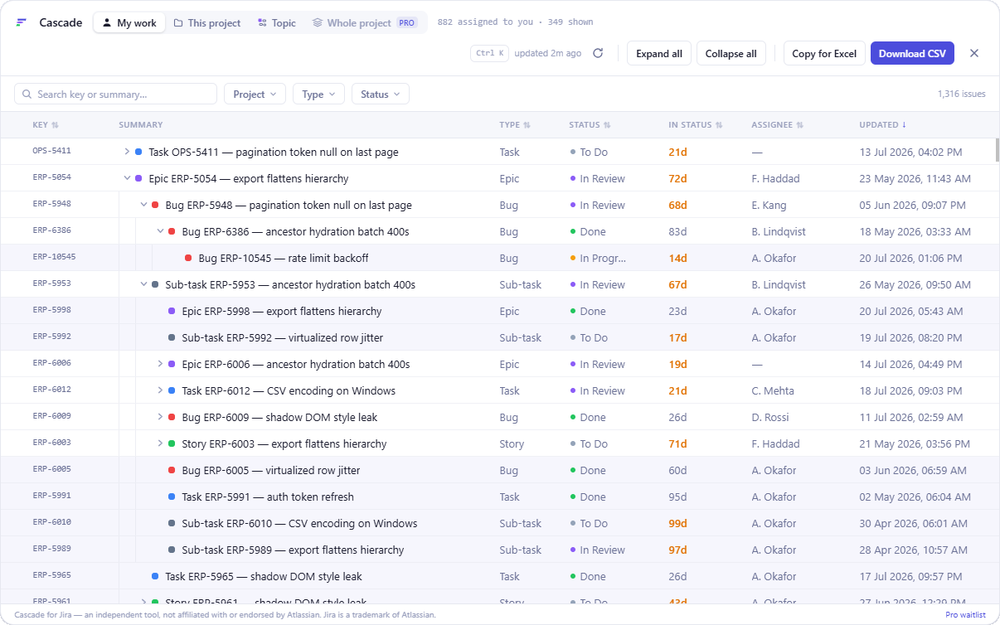

<picture>
  <source media="(prefers-color-scheme: dark)" srcset="assets/banner-dark.svg">
  
</picture>

# Ahmad Fiaz Jan

I build small web products, launch them, and try to get people to use them. I also work at Omnesoft, on the web app for their ERP.

## What I've shipped

- **[Cascade for Jira](https://cascadeforjira.com)**: a Chrome extension that shows Jira issues as a tree and marks what changed since your last visit. [How I built it](https://github.com/ahmedfiazjan/cascade-for-jira-case-study).

  

- **[Extension Preflight](https://extensionpreflight.com)**: checks a Chrome extension for the common reasons the Chrome Web Store rejects one, before you submit it. It runs in your browser, and the [scanner is open source](https://github.com/ahmedfiazjan/extension-preflight).
- **[RowBalance](https://rowbalance.com)**: turns bank statements (PDF, CSV, OFX and more) into Excel, CSV or QuickBooks files and checks the totals. It reads your statements in your browser. [How I built it](https://github.com/ahmedfiazjan/rowbalance-case-study).
- **[TaxWizard.pk](https://taxwizard.pk)**: tax calculators for Pakistan. I use it to learn SEO.

I build with Claude Code. I share the agent skills I use in [skills](https://github.com/ahmedfiazjan/skills), and post what I learn on [LinkedIn](https://www.linkedin.com/in/ahmedfiazjaan/) and [X](https://x.com/ahmadfiazjan).

[ahmadfiaz.me](https://ahmadfiaz.me) · [hello@ahmadfiaz.me](mailto:hello@ahmadfiaz.me)
